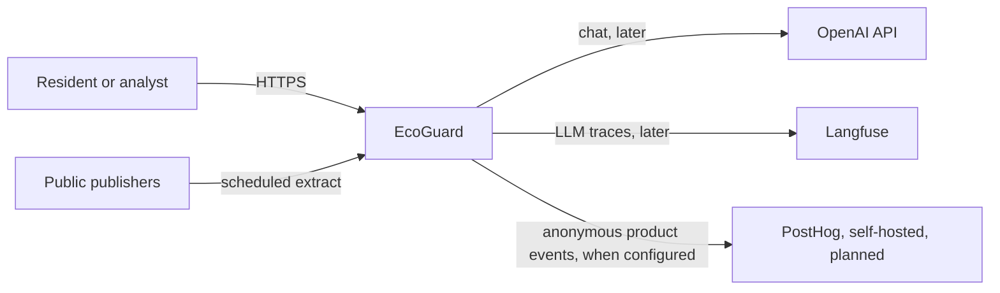
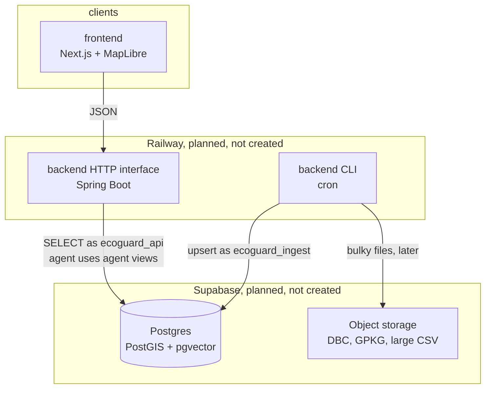
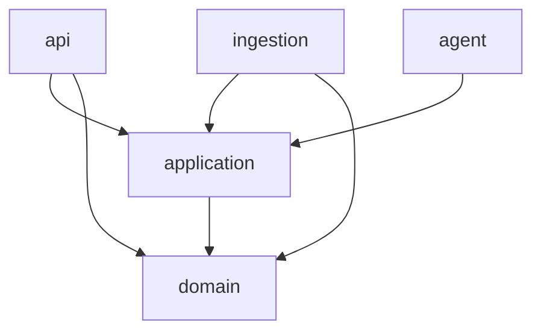
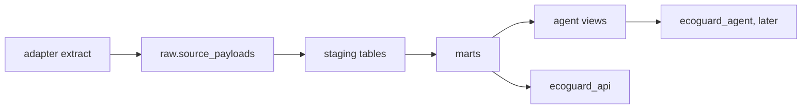

# Architecture

EcoGuard is city risk intelligence for the municipality of São Paulo. This page is the C4 view and the engineering standard for how code is arranged. Source access is in [data-sources.md](data-sources.md). Scores are in [risk-methodology.md](risk-methodology.md). Analytics events are in [analytics.md](analytics.md). Threats are in [../security/threat-model.md](../security/threat-model.md).

Checked against live publishers on 2026-11-02 unless a catalog row says otherwise.

## System context

People read maps and ask questions. Publishers remain the source of record. The model is not a source of measurements. Product analytics must not receive personal data. See the LGPD note in `security/lgpd.md`.

Out of the MVP: other cities, streaming, accounts, email or SMS alerts, and trained forecast models.

## Containers

| Container | This repository | Later |
| --- | --- | --- |
| `frontend/` | Screens 00–06. MapLibre reads `GET /districts`. Scores and alerts stay empty | Choropleth classes, alert feeds, nonce CSP |
| `backend/api` | Health, OpenAPI, districts, risk config, analyst | Score and alert reads |
| `backend/ingestion` | InfoDengue, Open-Meteo, GeoSampa districts | Remaining sources, score job |
| `backend/agent` | Spring AI answer when a key is set. SQL limited to `agent` views | Langfuse traces |
| `db/` | Schemas, roles, agent views. Districts load by the collector, not by a migration | Supabase project |
| `infra/` | Local Postgres image and compose | Railway, when someone asks to deploy |

Nothing in this repository creates a cloud resource.

## Backend shape

Gradle modules: `domain`, `application`, `ingestion`, `api`, and `agent`. `domain` and `application` do not depend on Spring. See [ADR 0009](adr/0009-hexagonal-backend.md).

Ingestion is `RunIngestion`. A `SourcePort` returns domain records. The use case upserts `raw`, `staging`, and `marts.districts`, then writes `ops.job_runs`. Re-runs update the natural key. Use-case tests pass an in-memory store.

The analyst answers `POST /analyst/questions` when `OPENAI_API_KEY` is set and returns 503 otherwise. SQL it is allowed to read is the `agent` schema. That role has no grant on `raw`, `staging`, or base `marts` tables.

## Frontend shape

The folder rules, the DTO boundary, and the lint checks are in [frontend/ARCHITECTURE.md](../frontend/ARCHITECTURE.md). Routes in `frontend/src/app` only compose a screen. Feature code is `components`, `hooks`, `api`, and `model`. Shared controls live in `src/components/ui` and use design tokens. `fetch` stays in `src/lib/api`.

| Route | Screen | State |
| --- | --- | --- |
| `/` | 00 What is EcoGuard | Entry. Links to the map and the analyst |
| `/overview` | 01 Overview | District count from the API. Score chart is an explicit no-data series, or a table |
| `/map` | 02 Risk map | MapLibre polygons, dashed no-data outline, or a table |
| `/districts` | 03 District detail | List and one district. Score mark is no-data |
| `/analyst` | 04 AI City Analyst | AI tag, error disclaimer, feedback, regenerate |
| `/alerts` | 05 Alerts | Empty. No example alerts |
| `/sources` | 06 Sources and methodology | Weights from `/risk-config` |

There is no observability screen. It was not designed.

A screen component renders. Its hook calls that feature's `api` module, which maps DTOs from `src/lib/api`. Shared analytics validates events in memory and sends them to PostHog only when both public env vars are set.

Light-theme accent is `#076E94`. The wordmark uses it at 24px, weight 600. Control borders use `--border-strong`.

## Data flow

`marts.districts` starts empty. The job `geosampa-districts` upserts the 96 official features. The only legal `source` value is `geosampa:wfs:geoportal:distrito_municipal`. The file `design/src/distritos-sp.geojson` is a 2016 dev fixture (`ds_codigo`, `ds_nome`, CRS84, repository `codigourbano/distritos-sp`). It is not loaded by the backend, the frontend, or the migrations.

`marts.risk_score_config` holds the confirmed weights 0.40, 0.35, and 0.25. They stay in that row so a change is data. `OverallWeights.combine` in the domain refuses a row that is not `status = confirmed`, and returns null if any pillar is missing.

## Repository map

| Path | Owns |
| --- | --- |
| `backend/` | API, workers, analyst boundary |
| `frontend/` | Web app |
| `infra/` | Local Postgres image, compose, Railway notes, CI ownership |
| `security/` | Threat model, ASVS target, LLM risks, LGPD, scanner config |
| `docs/` | Architecture, ADRs, catalog, runbooks, analytics |
| `db/` | SQL migrations |
| `design/` | Design originals, including the 2016 fixture |

GitHub Actions loads `.github/workflows` only. Those files are owned by `infra/` and documented in `infra/ci/README.md`.
