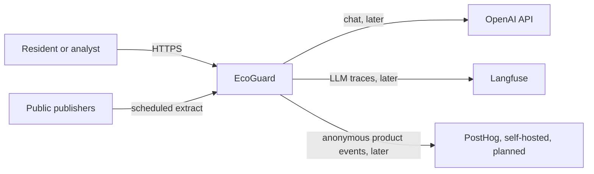
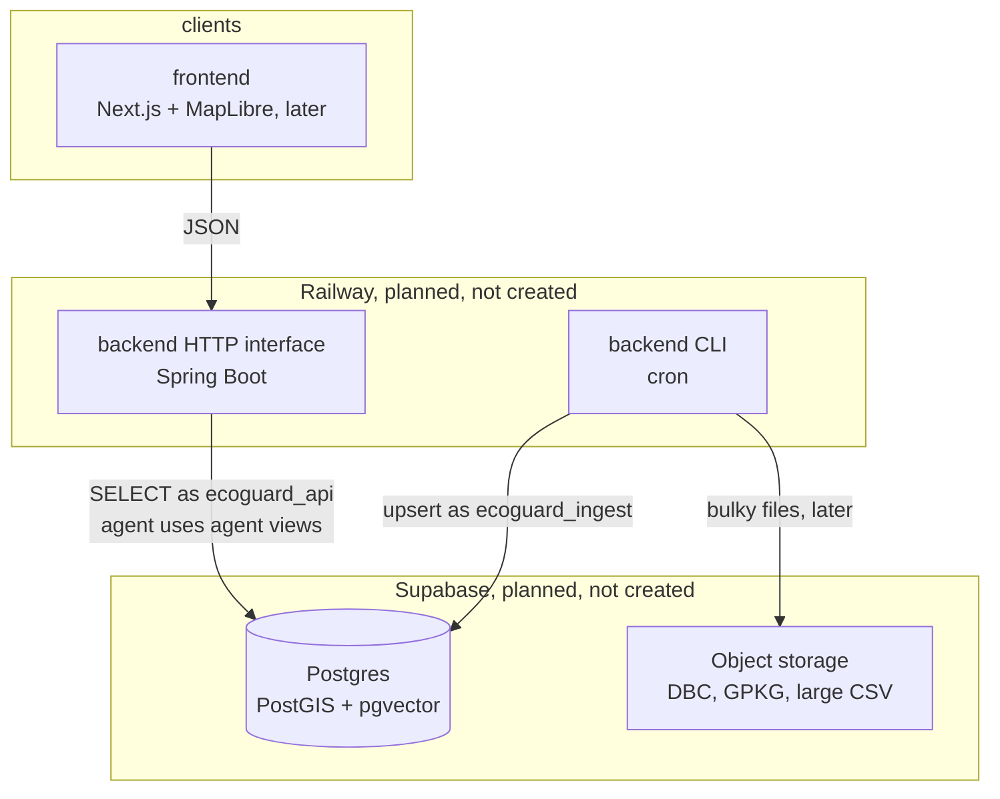
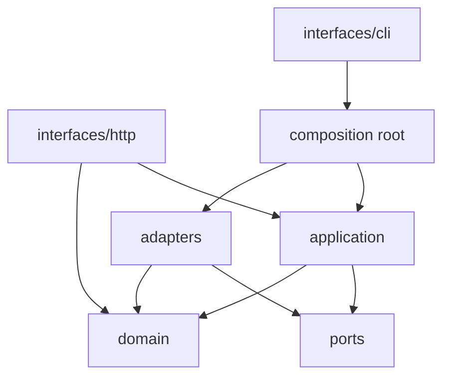
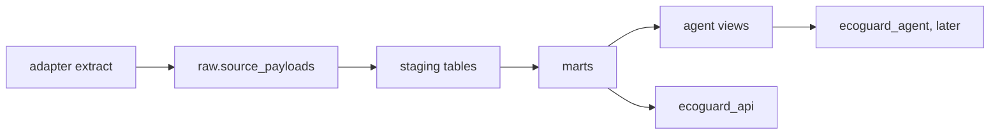

# Architecture

EcoGuard is city risk intelligence for the municipality of São Paulo. This page is the C4 view and the engineering standard for how code is arranged. Source access is in [data-sources.md](data-sources.md). Scores are in [risk-methodology.md](risk-methodology.md). Analytics events are in [analytics.md](analytics.md). Threats are in [../security/threat-model.md](../security/threat-model.md).

Checked against live publishers on 2026-11-02 unless a catalog row says otherwise.

## System context

People read maps and ask questions. Publishers remain the source of record. The model is not a source of measurements. Product analytics must not receive personal data. See the LGPD note in `security/lgpd.md`.

Out of the MVP: other cities, streaming, accounts, email or SMS alerts, and trained forecast models.

## Containers

| Container | This foundation | Later |
| --- | --- | --- |
| `frontend/` | Theme, logo, route plan. `/` is screen 00 | Six designed screens plus 00, MapLibre |
| `backend/` interfaces/http | `GET /health`, OpenAPI, rate limit, security headers | Read endpoints |
| `backend/` interfaces/cli | InfoDengue and Open-Meteo | Remaining sources, score job |
| `backend/agent` | Ports only. No model client | LangGraph on `ecoguard_agent` |
| `db/` | Schemas, roles, agent views | Supabase project, district load |
| `infra/` | Local Postgres image and compose | Railway, when someone asks to deploy |

Nothing in this repository creates a cloud resource.

## Backend shape

The backend is a Gradle build. `domain` and `application` do not depend on Spring. Dependency direction is inward.

| Layer | May import | Must not import |
| --- | --- | --- |
| `domain`, `application` | the JDK and JTS | Spring, JDBC drivers, OpenAI |
| `application` | domain, ports | the same frameworks |
| `ports` | domain | adapters, frameworks |
| `adapters` | ports, domain, drivers | nothing from `interfaces` |
| `interfaces` | application, domain, composition | source SQL and HTTP clients directly |
| `composition.py` | adapters and application | — |

`composition.py` is the only wiring point. Tests of a use case pass an in-memory store and a fake HTTP transport. A test under `backend/tests/test_boundaries.py` fails if `domain`, `application`, or `ports` import a framework.

Ingestion is one use case: `run_ingestion`. A source adapter returns domain records. The use case upserts `raw` and `staging` and writes `ops.job_runs`. Re-runs update the natural key in place.

The analyst package defines `RiskLookup`, `AllowlistedSql`, and `DocumentSearch`. No implementation is registered. SQL, when it exists, may read the `agent` schema only. Those views are the allowlist. The role has no grant on `raw`, `staging`, or base `marts` tables.

## Frontend shape

Features own a screen. Shared code is routing, analytics, and the theme.

| Route | Screen | State in this PR |
| --- | --- | --- |
| `/` | 00 What is EcoGuard | Placeholder. Entry. Links to the map and the analyst |
| `/overview` | 01 Overview | Placeholder |
| `/map` | 02 Risk map | Placeholder |
| `/districts` | 03 District detail | Placeholder |
| `/analyst` | 04 AI City Analyst | Placeholder |
| `/alerts` | 05 Alerts | Placeholder |
| `/sources` | 06 Sources and methodology | Placeholder |

There is no observability screen. It was not designed.

UI, client state, and server data stay apart: placeholders have no client store and no data fetch. When a screen is built, `features/<name>/ui` renders, `features/<name>/state` holds view state, and `features/<name>/data` calls the API. Shared analytics is a validated in-memory tracker until PostHog is configured.

Light-theme accent (`#0A7EA8`) is about 4.3:1 on the page background. It is used only on the wordmark (24px, weight 600).

## Data flow

`marts.districts` is empty. The only legal `source` value is `geosampa:wfs:geoportal:distrito_municipal`. The file `design/src/distritos-sp.geojson` is a 2016 dev fixture (`ds_codigo`, `ds_nome`, CRS84, repository `codigourbano/distritos-sp`). It is not loaded by the backend, the frontend, or the migrations.

`marts.risk_score_config` holds the confirmed weights 0.40, 0.35, and 0.25. They stay in that row so a change is data. `OverallWeights.combine` in the domain refuses a row that is not `status = confirmed`, and returns null if any pillar is missing.

## Repository map

| Path | Owns |
| --- | --- |
| `backend/` | API, workers, analyst boundary |
| `frontend/` | Web app |
| `infra/` | Local Postgres image, compose, Railway notes, CI ownership |
| `security/` | Threat model, ASVS target, LLM risks, LGPD, scanner config |
| `docs/` | Architecture, ADRs, catalog, runbooks, analytics |
| `db/` | SQL migrations |
| `design/` | Design originals, including the 2016 fixture |

GitHub Actions loads `.github/workflows` only. Those files are owned by `infra/` and documented in `infra/ci/README.md`.
